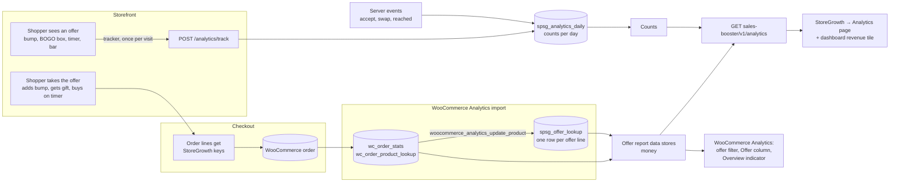
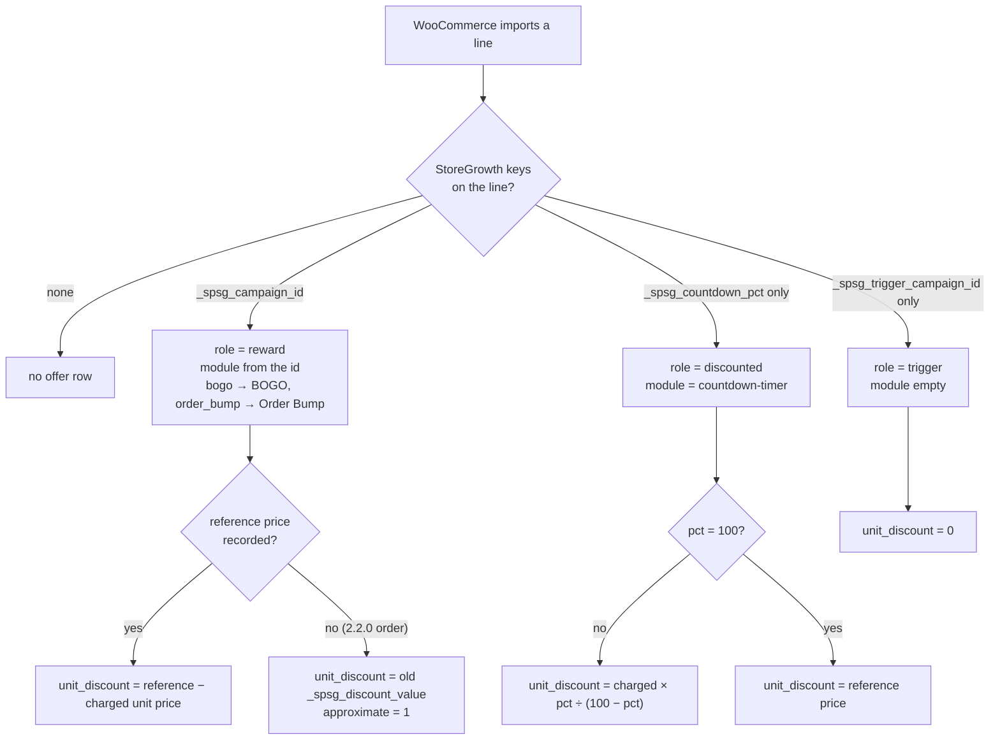
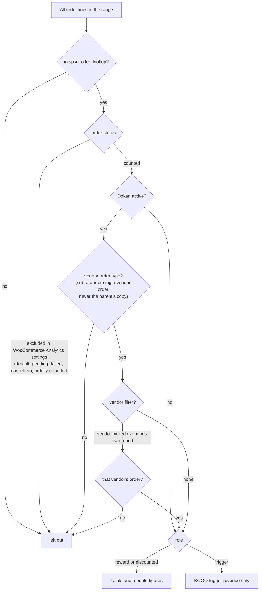
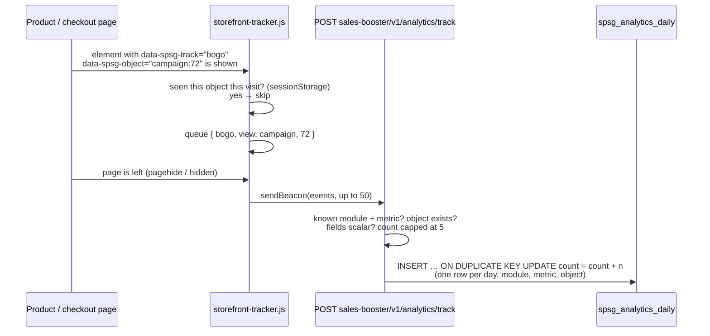
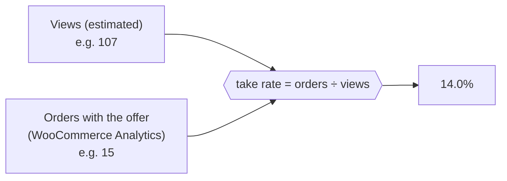
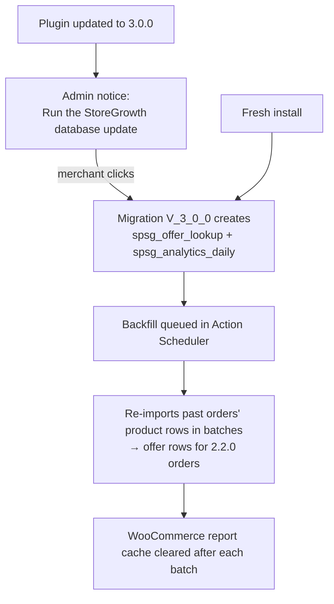

# Module analytics: how it works

How StoreGrowth measures what its offers sold and gave away: what is recorded, where it is stored, and how every figure on the Analytics page is calculated. The decisions behind it are in [ADR-012](../adr/ADR-012-module-analytics.md); the build plan is in [README.md](README.md).

**Two kinds of numbers:**

| Kind | Examples | Source | Exact? |
|---|---|---|---|
| **Money** | revenue, discount given, orders, items sold | WooCommerce Analytics (the same tables WooCommerce's own reports read) | Yes, follows WooCommerce's rules (statuses, refunds, dates) |
| **Counts** | views, accepts, swaps, add-to-carts, bar clicks | StoreGrowth's counts table, filled by the storefront and the server | Estimates (ad blockers, cached pages, bots) |

Rates such as **take rate** divide money-side orders by counted views, so they are estimates too.

---

## 1. The big picture

StoreGrowth never computes money by looping over orders. It writes a few keys on the order lines at checkout, lets WooCommerce Analytics import the order as it always does, mirrors the offer lines into one small table, and reads totals with WooCommerce's own report queries narrowed to those lines.

---

## 2. What is recorded at checkout

Keys are written on the order through the WooCommerce CRUD API (HPOS-safe), in classic and blocks checkout, and **never on subscriptions** (renewals don't inherit them).

| Key | Written on | Value | Used for |
|---|---|---|---|
| `_spsg_campaign_id` | lines an offer **added or priced**: bump product, BOGO gift | `order_bump:7`, `bogo:72` | which offer, which module |
| `_spsg_reference_price` | the same lines | unit price the shopper would have paid without StoreGrowth's discount, excl. tax | the discount |
| `_spsg_trigger_campaign_id` | the line that **unlocked** a BOGO gift | `bogo:72` | "trigger revenue" |
| `_spsg_countdown_pct` | a line bought while a Countdown Timer discount was live (and no other offer priced it) | `20` (percent) | the timer's discount |
| fee line meta `_spsg_campaign_type = progressive_discount` (+ threshold, mode, value, subtotal) | the Free Shipping Bar's discount **fee** line | | the bar's discount |
| order meta `_spsg_fsb_threshold` | the order, in free-shipping mode when the threshold was met | `50` | "orders over the threshold" |

Precedence: a line priced by a bump or a gift is a **reward** line; the countdown key is only written when no reward key is there, so one discount is never counted twice.

---

## 3. From order line to offer row

When WooCommerce Analytics imports an order (right away, or by its scheduled import), it writes one `wc_order_product_lookup` row per line and fires `woocommerce_analytics_update_product`. StoreGrowth answers with one `spsg_offer_lookup` row for each line that carries a key.

- **Charged unit price** = the line's subtotal ÷ quantity, **before coupons and excluding tax**. Coupon savings are never counted as an offer's discount.
- The discount is never negative (`max( 0, … )`).
- **Refunds:** a refund line gets its own row that copies the original line's figures. WooCommerce stores a refunded quantity as negative, so the refunded discount is subtracted automatically (section 4).
- If the order changes and is re-imported, its rows are rebuilt; deleting an order deletes its rows.

**Worked examples**

| Line | Charged | Key | unit_discount |
|---|---|---|---|
| Socks bump, 2 × 15.00, worth 20.00 | 15.00 | campaign `order_bump:7`, reference 20 | 20 − 15 = **5.00** |
| Free gift cap, 1 × 0.00, worth 18.00 | 0.00 | campaign `bogo:72`, reference 18 | 18 − 0 = **18.00** |
| Hoodie on a 20% timer, 1 × 36.00 | 36.00 | countdown 20 | 36 × 20 ÷ 80 = **9.00** (it was 45.00) |
| T-shirts that unlocked the gift, 2 × 20.00 | 20.00 | trigger `bogo:72` | **0** (counted as trigger revenue) |

---

## 4. Money: how each figure is calculated

The offer data stores (`Analytics\Reports\Offers\…`) extend WooCommerce's **Products** report queries and join `spsg_offer_lookup` on `(order_item_id, order_id)`. So every money figure is WooCommerce's own column, limited to offer lines:

| Figure | Formula (over the lines in the range) |
|---|---|
| **Revenue** | `SUM( product_net_revenue )`: what the shopper paid for the offer lines, after coupons, before tax and shipping, less refunds |
| **Discount given** | `SUM( unit_discount × product_qty )`: refund rows have a negative quantity, so refunds take their discount back out |
| **Orders** | `COUNT( DISTINCT order_id )` of orders with an offer line (refund rows aren't counted as orders) |
| **Items sold** | `SUM( product_qty )` |

**Which lines count**

- **Dates** are the order's creation date in the store's timezone (WooCommerce's Products report uses the same).
- **Dokan** copies every line to the vendor sub-orders, so the parent order and its sub-orders would count twice. Only the rows Dokan's own reports count are read: sub-orders and single-vendor orders. A vendor reading their reports, or an admin who picks a vendor, gets only that vendor's orders.
- **Fully refunded orders** are left out. WooCommerce's full-refund rows skip free (0.00) gift lines, so their cost would otherwise stay behind.

### Totals, modules, campaigns

| Where | Lines | Notes |
|---|---|---|
| **Totals** (Revenue, Discount, Orders, Items) | `reward` + `discounted` | the offers' own lines; trigger lines are **not** in the total |
| **Revenue per day by offer** (chart) | per module, per day | BOGO's line = gift revenue **+ trigger revenue**, so the lines don't add up to the Revenue tile |
| **Order Bump card** | module `upsell-order-bump` | revenue of the bump lines |
| **BOGO card** | module `bogo` | Gift revenue (often 0, gifts are free), Gift cost (= discount), Orders with a gift, **Trigger revenue** (role `trigger`, shown here only) |
| **Countdown Timer card** | module `countdown-timer` | Revenue during timers, Discount given (what the timer took off) |
| **Campaigns table** | grouped by `campaign_id` | named from the BOGO and order bump tables |
| **Products on a timer** | Countdown lines grouped by product, joined with the timer's counts | "Timer only" = viewed with a timer, no sale at a timer price, and no timer discount set now |
| **Dashboard → Revenue** | the Revenue total of the last 30 days | "—" while WooCommerce Analytics is off |

---

## 5. Counts: views, clicks, add-to-carts

- **Once per visit:** views (and add-to-carts marked `data-spsg-track-add-to-cart`) count once per browser session and object.
- **Server-side counts:** some events are counted on the server, never from the browser:
  - Order Bump: classic-checkout views (once per WooCommerce session), accepts and removals.
  - BOGO: gift added and gift swapped.
  - Free Shipping Bar: threshold reached, once per session.
- **The endpoint is public:** it has to work on cached pages, so there is no nonce. It only adds to known module/metric pairs for objects that exist, and caps each event at 5. It rate-limits per IP only on sites with a persistent object cache. That's why counts are labelled **estimates**.
- **Before the update:** nothing is counted until the StoreGrowth database update has created the tables.

---

## 6. Conversion rates

All rates are `round( 100 × part ÷ base, 1 )` and show "—" when the base is 0.

| Rate | Part (money side) | Base (counts) |
|---|---|---|
| **Order Bump take rate** | orders containing the bump | bump views (checkout) |
| **BOGO take rate** | orders with a gift | offer views (product pages) |
| **Campaign take rate** | that campaign's orders | that campaign's views |
| **Countdown add-to-cart rate** | add-to-carts with a timer shown | timer views |

**Example:** the "Socks with every hoodie" bump was viewed 67 times at checkout in the last 30 days, and 13 orders contained it → take rate = 13 ÷ 67 = **19.4%**.

**Caveat:** views are only counted from this release on, but orders go back further. Right after an update, a range that reaches before the update can read high (even over 100%) until views catch up.

---

## 7. Free Shipping Bar ("Helped")

The bar's discount is a **fee** (a negative cart fee), not a product line, so it isn't in WooCommerce's product lookup. It's read from the tagged fee lines with WooCommerce Analytics' rules:

| Figure | Formula |
|---|---|
| Orders with the discount | orders with a tagged fee line |
| Discount given | `SUM( ABS( fee line total ) )` |
| Orders over the threshold | orders with the discount + orders with `_spsg_fsb_threshold` (free-shipping mode) |
| Views, clicks, dismissals, carts that reached it | counts (section 5) |

- **Which orders:** only orders with no parent (`parent_id = 0`). The fee and the order key stay on the order the checkout created; Dokan copies neither to sub-orders, and refunds are rows with a parent. So nothing counts twice.
- **Statuses and dates:** the same excluded statuses, fully refunded orders left out, and the order's creation date.
- **Not offer revenue:** the bar gives a discount, not a sale, so it isn't in the Revenue total or the chart. It's labelled **Helped**, and under a vendor filter it stays store-wide.

---

## 8. Inside WooCommerce Analytics

| Feature | What it does |
|---|---|
| **"StoreGrowth offer" filter** (Orders and Products reports) | `spsg_offer = any \| upsell-order-bump \| bogo \| countdown-timer`. **Orders report:** whole orders that had an offer line, plus their refunds. **Products report:** only the offer lines. Applies to tiles, chart, table and CSV export, and is part of WooCommerce's cache key. |
| **Offer column** (Orders report and its CSV) | the modules each order had offers from |
| **Overview indicator "StoreGrowth offer revenue"** | the same Revenue total as the Analytics page for the chosen range; vendor-scoped with Dokan |

Why the Orders report's numbers can differ from the Analytics page:
- **It counts whole orders, not just offer lines.**
- **It uses WooCommerce's "Date type" setting:** the paid, completed or created date.

---

## 9. Lite and Pro

| | Lite | Pro |
|---|---|---|
| Range | last 7 or 30 days (enforced on the server) | any range, custom dates |
| Campaigns / products listed | top 3 | all |
| Compare with the previous period | — | totals and module figures with % change |
| Vendor filter (Dokan) | — | yes |
| CSV export | — | campaigns, daily figures |

WooCommerce Analytics' own reports (filter, column, indicator) follow WooCommerce's date range in both.

---

## 10. Setup, upgrade and backfill

- Until the update runs, nothing is written or counted and the page asks for the update.
- **Orders from 2.2.0:**
  - Gift and bump lines get an approximate discount, from the old `_spsg_discount_value`.
  - Trigger lines and countdown lines start at this release.
- **WooCommerce Analytics off:** the page shows the counts and a notice to turn Analytics on. No money is read, and there's no fallback.

---

## 11. Checking the numbers

- **Demo data:** `wp eval-file tests/e2e/bin/seed-analytics.php` seeds products, campaigns, ~120 orders over 90 days, refunds and counts. `… clean` removes all of it.
- **Raw rows:** `SELECT * FROM wp_spsg_offer_lookup WHERE order_id = …` shows one order's offer rows (module, role, unit_discount).
- **Same range, three places:** the Analytics page's Revenue, WooCommerce → Analytics → Products with "StoreGrowth offer: Any offer", and the Overview indicator should match.
- **Code:**

  | Code | Path |
  |---|---|
  | Checkout keys | `includes/Attribution/OfferAttribution.php` |
  | Countdown key | `modules/countdown-timer/includes/OrderAttribution.php` |
  | Free Shipping Bar keys | `modules/progressive-discount-banner/includes/OrderAttribution.php` |
  | Offer rows | `includes/Analytics/OfferLookup.php` |
  | Report queries | `includes/Analytics/Reports/` |
  | Counts | `includes/Analytics/Counter.php`, `TrackController.php`, `assets/js/storefront-tracker.js` |
  | Report | `includes/Analytics/AnalyticsController.php` |
  | WooCommerce Analytics | `includes/Analytics/WcAnalytics.php`, `OffersStatsController.php` |
  | Page | `src/admin/pages/analytics/` |
